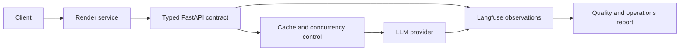

# LLM Application Deployment Project

Use this repository as a **template** for your LLM deployment project.
Deploy a production-shaped Northstar support assistant with a typed inference
API, a reproducible container, resilient caching, and observability for service
health and LLM-specific behavior. Create pull requests in your own copy even if
you are working alone, and use them to track your progress.

This assignment combines the preceding FastAPI, container deployment, and
Langfuse units. Start with a local, repeatable baseline, then collect evidence
from the hosted service.

## Learning Objectives

By the end of this repository, you should be able to:

- Build and deploy a complete LLM-powered application with an inference API,
  containerization, hosted deployment, caching, and production observability.
- Demonstrate and interpret both service-health metrics such as latency and
  errors and LLM-specific metrics such as token usage, cost, and answer quality.

## Learning Path



| File / Folder | Description |
|---|---|
| [**Project Description**](project-description.md) | Scenario, milestones, deliverables, and acceptance checklist. |

### Additional Folders and Files

| File / Folder | Description |
|---|---|
| [**data/evaluation**](data/evaluation/cases.json) | Shared functional and cache-evaluation cases. |
| [**data/operations**](data/operations/load_profile.json) | Load profile and service objectives for the report. |
| [**scripts/load_test.py**](scripts/load_test.py) | Load probe for latency and error-rate checks. |
| [**solution**](solution/README.md) | Runnable reference scaffold and tests. Inspect after attempting the project. |
| [**.env.example**](.env.example) | Default settings and credential placeholders. |
| [**pyproject.toml**](pyproject.toml) | Project configuration and dependencies. |
| [**uv.lock**](uv.lock) | Dependency lock file. |

## Prerequisites

- **Docker Desktop**: required to build the API image and run the container in milestone 1. Follow the [installation instructions](https://docs.docker.com/get-docker/) if you do not have it yet. Make sure it is **installed and running** before you start milestone 1.

- **Render account**: required to deploy the service in milestone 2. [Sign up](https://dashboard.render.com/register) for free with your GitHub account.

- **Langfuse account**: required to record and inspect traces in milestone 2. [Sign up](https://cloud.langfuse.com) for the free Hobby plan (no credit card required) and create a project used only for this exercise.

> [!NOTE]
> **Windows Users:** The commands in this repository use bash syntax. Use **Git Bash** (installed with [Git for Windows](https://git-scm.com/downloads/win)) instead of PowerShell to run them.

## Setup

Use [uv](https://docs.astral.sh/uv/getting-started/installation/) 0.13.5 or newer
and Python 3.13.17 or a newer 3.13 patch release, as defined in
[`.python-version`](.python-version).

> [!NOTE]
> Throughout these steps, text in angle brackets like `<repo-name>` is a **placeholder**. Replace it, including the `< >` brackets, with your own value. For example, `cd <repo-name>` becomes `cd mle-llm-application-deployment-project`.

### 1. Create the Repository from the Template

Click **Use this template** on GitHub.

When creating the repository:

- Set yourself as the **Owner**
- Choose a repository name
- Disable **Include all branches**
- Click **Create repository**

> [!IMPORTANT]
> If you are working in pairs or groups, only **one person** should complete this step.

---

### 2. Add Collaborators (Pairs/Groups Only)

If working with teammates:

1. Open the repository on GitHub
2. Go to **Settings → Collaborators**
3. Add your teammates as collaborators
4. Share the repository link with your team

Teammates should accept the invitation before continuing.

---

### 3. Clone the Repository

Copy the SSH URL from the **Code** button on GitHub, then run:

```bash
git clone <copied-ssh-url>
```

The copied SSH URL will look like `git@github.com:<your-username>/<repo-name>.git`.

---

### 4. Move into the Project Folder and Install Dependencies

The command below installs all dependencies and creates a virtual environment in `.venv/`.

```bash
cd <repo-name>
uv sync
```

---

### 5. Set Up Environment Variables

Copy the provider, service, and tracing settings:

```bash
cp .env.example .env
```

Start with an offline run and local trace output to check your own API. For
that path, set `MODEL_PROVIDER=dry` in `.env` (the copied file defaults to
`groq`, which needs a key). `TRACE_SINK=jsonl` is already set. For a live
run, use the matching provider, model, and credentials from
[`.env.example`](.env.example).

> [!CAUTION]
> Never commit `.env`. It is git-ignored because environment files often hold secrets. Only `.env.example`, with placeholder or default values, belongs in the repository.

---

### 6. Open the Repository in VS Code

> [!NOTE]
> Make sure you open VS Code from the project root so it automatically detects the environment created by `uv sync`.

Launch VS Code in the project root folder:

```bash
code .
```

Select the Python interpreter in `.venv/` created by `uv sync`. Run the [reference solution commands](solution/README.md#run-the-offline-evaluation) from the project root.

## Required Deliverables

Your repository must include:

- a typed inference API with health, readiness, and generation routes behind a
  replaceable provider interface,
- cache and capacity controls: a parameter-aware cache key, TTL, bounded
  concurrency, and timeouts,
- a Dockerfile that runs the same service locally and on Render,
- the service deployed as a Free Render web service, with its URL in the report,
- Langfuse observations with nested stages, token usage, cost, latency, and a
  quality score,
- tests covering valid requests, invalid input, and upstream failures,
- `reports/deployment_report.md` comparing functional and load results with the
  supplied objectives and justifying a deployment recommendation.

## References & Further Reading

- Render: [Free Instances](https://render.com/docs/free) / [Docker on Render](https://render.com/docs/docker) / [Blueprint Specification](https://render.com/docs/blueprint-spec)
- Langfuse: [Observability](https://langfuse.com/docs/observability/overview) / [Scores](https://langfuse.com/docs/evaluation/scores/overview)
- [FastAPI Deployment Concepts](https://fastapi.tiangolo.com/deployment/concepts/)
