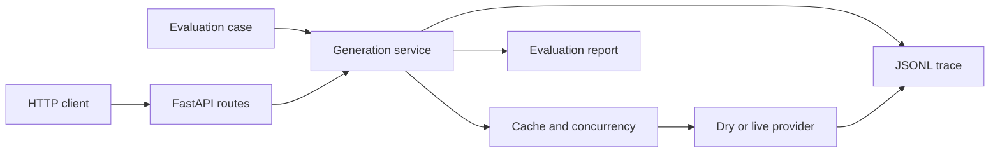

# Reference Solution

This folder contains a reference scaffold for the Northstar
deployment project. It separates provider calls, service controls, API routes,
evaluation, deployment configuration, and traces so each operational boundary
can be tested independently.

## Read In Three Steps

1. Follow one request from [app.py](deployment_project/app.py) through
   [service.py](deployment_project/service.py) to [provider.py](deployment_project/provider.py).
   [models.py](deployment_project/models.py) defines the contracts.
2. Inspect cache, concurrency, and deadlines in the service;
   [tracing.py](deployment_project/tracing.py) exports JSONL or Langfuse Python SDK v5
   observations with usage, release, and heuristic scores.
3. Run [evaluation.py](deployment_project/evaluation.py), then inspect the
   [Dockerfile](Dockerfile) for deployment and the reference Blueprint
   [render.yaml](render.yaml) for the Render service settings.



## Run The Offline Evaluation

```bash
uv run python -m solution.deployment_project inspect-data
uv run python -m solution.deployment_project evaluate
uv run pytest solution/tests
```

Evaluation writes `reports/generated/evaluation.md` and
`solution/generated/evaluation_traces.jsonl`. It does not overwrite the
[checked-in example report](reports/reference_evaluation.md) or API traces.
Expect five cases, a load profile of 40 requests at concurrency 5, and a
5/5 result in the dry evaluation report. The repeated refund case verifies
caching; the other cases have no repeated request. The evaluation calls
the service directly; route tests and a load probe test the HTTP layer.
Unit tests ignore `.env`, use the dry provider and keep their traces in temporary folders.

## Follow One HTTP Request

Run from the repository root. Use the default cache TTL and a fresh process
so the first request is a miss. Choose a separate trace file from the
evaluation output:

```bash
MODEL_PROVIDER=dry TRACE_SINK=jsonl TRACE_PATH=solution/generated/walkthrough-traces.jsonl \
  uv run uvicorn solution.deployment_project.app:app
```

From another terminal, run the two refund requests in
[milestone 1](../project-description.md#milestone-1---reproducible-service).
Both should return a typed result, model `dry-northstar-v1` and a `trace_id`. The
second should have `cache_hit: true`. Use the two response IDs to find the
matching JSONL records. To compare the latest two records without printing
raw prompts or answers:

```bash
uv run python - <<'PY'
import json
from pathlib import Path

path = Path("solution/generated/walkthrough-traces.jsonl")
for line in path.read_text().splitlines()[-2:]:
    trace = json.loads(line)
    print(trace["trace_id"], trace["cache_hit"], trace["spans"], trace["usage"])
PY
```

Expect a miss with `cache-lookup` and `llm-generation`, followed by a hit
with only `cache-lookup` and zero new provider tokens. The API still reports
the cached answer's original token counts. Stop Uvicorn with Ctrl+C before
running the container on the same port.

## Interpret The Reference Results

The API defaults to `MODEL_PROVIDER=groq` and requires `GROQ_API_KEY` in `.env`.
Set `MODEL_PROVIDER=dry` explicitly for an offline run. For another live provider,
select `mistral`, `openrouter`, `google` or `openai` and set the matching key and
model from `.env.example`. `init_chat_model` selects the native adapter.
`/ready` confirms local initialization and identifies the configured provider
model; it does not probe upstream availability. OpenRouter may select a fallback,
so the generation response identifies the model actually used.

The dry provider returns canned answers and word-count token estimates. The live provider
receives only the user prompt: it has no approved Northstar policy context.
Do not treat either path as a validated policy assistant.

The cache is process-local, limited to 1,024 entries and lost on restart.
Concurrent misses may duplicate calls. API usage describes the returned answer;
trace usage counts only new provider tokens. Failed calls report zero known
usage, which does not prove the provider charged nothing.

The evaluation checks expected whole words or phrases and cache behavior, not
negation or semantic support. The quality heuristic
can reward an incorrect answer containing those words; it is not a factuality score.
Evaluation always uses the offline dry provider and JSONL, regardless of live-service settings.
Every repeated response is checked. Cache results are N/A for single-request
cases; mean latency includes both the initial miss and subsequent hits.

## Deployment Notes

The checked-in [render.yaml](render.yaml) is a reference Blueprint for the
service settings on one Free instance. In Render, the Blueprint creation flow
asks for a payment method even on the Free instance plan, so deploy with
**New > Web Service** and **Free** compute instead, and set the secrets in the
Render dashboard. JSONL is the default trace sink so the full
evaluation runs without credentials; set `TRACE_SINK=langfuse` to use the
included Langfuse Python SDK v5 exporter (Cloud or self-hosted Langfuse 4.59.0+). Document prompt/output masking before live
traffic.

The exporter omits raw text, records failures without answer-quality scores and
avoids generation observations on cache hits. JSONL still stores demo prompts
and answers locally.
Cloud observation durations measure export work, not original request stages;
use `request_latency_ms` metadata for the generation path, excluding trace export.
Measure end-to-end HTTP latency with the load probe. Add live nested
instrumentation, pricing and load evidence for the complete project requirements.
Telemetry failures are logged without turning successful generation into `502`.

From the repository root, test the container with:

```bash
docker build -f solution/Dockerfile -t northstar-deployment .
docker run --rm -e MODEL_PROVIDER=dry -e TRACE_SINK=jsonl \
  -p 127.0.0.1:8000:8000 northstar-deployment
```

Repeat the health and generation checks against the container. It has its
own cache and trace file. Stop it with Ctrl+C when finished; this temporary
container's traces are not saved on the host. Once deployed, the API is
public: anyone who finds its URL can use your provider quota. Keep local tests
on loopback, keep live tests brief, and only share the URL while it runs with
the dry provider.
